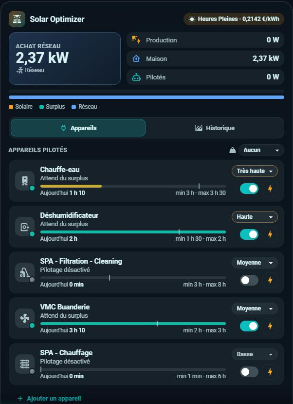
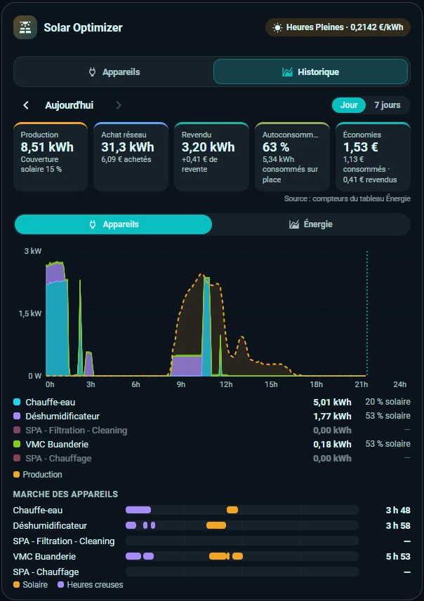

# ☀️ HOLM Solar Optimizer Card

[](https://hacs.xyz/)


[🇫🇷 Français](README.md) · 🇬🇧 English

**A modern interface for [Solar Optimizer](https://github.com/jmcollin78/solar_optimizer): live surplus, managed devices, history and settings, all in one card.**

Solar Optimizer stays the engine: the card only uses its entities, its actions and its own configuration forms. Nothing else to install, no entity to create, no restart.

### At a glance

- ⚡ **Live surplus**: production, home consumption, grid export or import, power managed by Solar Optimizer, and the current price (peak / off-peak).
- 🔌 **Managed devices**: state (running, forced, off-peak catch-up, condition not met, waiting for surplus…), editable priority, automatic-control switch and a **Force** button (1 h, 2 h, 4 h, 8 h or no limit).
- ⏱️ **Today's run time** with a gauge between the configured **minimum** and **maximum**, minimum on and off durations, off-peak time and daily reset time.
- 📈 **History for one day** (previous days included) **or 7 days**: production / consumption / surplus curves, off-peak bands, a timeline of each device's runs (solar or off-peak).
- 🟣 **Solar Optimizer's real gain**: what the managed devices' self-consumption earned you, in total and device by device.
- 💶 **Self-consumption and savings**: share used on site and share sold, in kWh and %, solar coverage, and savings in € computed with the real price at each moment.
- ⚙️ **Device settings** (administrators): edit every setting of a device or **add** a new one, using Solar Optimizer's own forms. The card also flags a usability condition wrapped in extra quotes and offers to fix it.
- 🗂️ **Compact**: only the live section at first, then two tabs opened with a click, like the other HOLM cards: **Devices** (with the number of running devices) and **History**.
- 🌍 **8 languages**, light and dark themes, mobile layout, visual editor.

| Devices tab | History tab |
|---|---|
|  |  |

### 🆕 What's new in 1.4.3

- 📖 **Solar Optimizer gain explained**: new “The Solar Optimizer gain in detail” section with a worked example, and help texts in the visual editor under the “Devices that would have run off-peak”, “Hidden devices” and battery options.

### What's new in 1.4.2

- ⏸️ **Pause between two activations**: a device waiting for its minimum delay between two activations shows “Pause between two activations · available at 09:49” instead of “Condition not met”. The card also tells apart the **daily maximum reached** and the **battery below threshold** (thanks to Jean-Marc Collin).
- 🟣 **Solar Optimizer gain**: a new history tile shows what Solar Optimizer really earns you. The home base load gets the solar first; the remaining solar used by the managed devices, which would have been sold without Solar Optimizer, is valued at (current buy price − sell price). Each device's gain shows under the Devices chart, and the former tile becomes “Solar savings” (all the self-consumed production). `offpeak_devices` option for devices that would have run off-peak without Solar Optimizer, such as a water heater: their gain uses the off-peak price provided by HOLM HP/HC. Idea by Jean-Marc Collin.
- 🌙 **Off-peak runs without HOLM HP/HC**: the “Device runs” timeline colours in purple the runs that start between the device's off-peak time and Solar Optimizer's reset time. Previously only HOLM HP/HC off-peak hours were recognised (thanks to Jean-Marc Collin).
- 🔋 **Battery**: a Battery tile joins the live section when a battery is set in Solar Optimizer, with its state of charge and power (charging or discharging). `battery_entity` and `battery_power_entity` options to pick other sensors.

### What's new in 1.4.1

- 🐛 **Energy meters in Wh**: an Energy dashboard meter in Wh (or MWh) is now converted to kWh. Previously its value was read as is, which inflated production, self-consumption and savings (thanks to Jean-Marc Collin).

### What's new in 1.4.0

- 👁️ **Choose the devices on the chart**: under the “Devices” chart, a click on a device hides or shows it, a double-click shows only that one; production can be hidden too, so the scale fits a small device. “Show all” button; the choice is remembered by the browser.

### What's new in 1.3.0

- 🔌 **“Devices” chart** in the history, shown by default, next to the “Energy” chart: each managed device's power, stacked under the production curve (day), or its kWh per day (7 days). Under the chart, each device's consumption and its **solar share**.
- 📏 **Real measurements**: the card finds the managed device's power sensor on its own (same device in Home Assistant). Otherwise, set it with `power_sensors`; failing that, consumption is estimated (max power × run time, marked ≈).
- `history_chart` option to choose the chart shown first.

- 📦 **Compact by default**: only the live section shows; the **Devices** and **History** tabs open with a click and close the same way. `default_tab` option to open a tab from the start.
- 🏷️ **Labelled bars**: “Production: 62 % used on site · 38 % sold” and “Home: 15 % solar · 85 % grid”.
- 🗂️ **Tabs**: managed devices and history move into two tabs, under the always-visible live section.
- 🧮 **Totals that match the Energy dashboard**: production, grid import, export and self-consumption are read from the same meters as Home Assistant's Energy dashboard (previously estimated from average power).
- 🔌 **New Grid import tile**, with its cost at the prices set in the Energy dashboard; the Sold tile shows the export income.

### With HOLM HP/HC

If you use the [**HOLM HP/HC, Tarification et abonnement**](https://github.com/kaaribou/holm-tarif) integration, the card detects it on its own (`sensor.tarif_actuel`): current period in the header, off-peak bands on the chart, feed-in price and resale tax for the savings, and the off-peak price for the gain of the `offpeak_devices`. Without it, the card uses the buy and sell prices set in Solar Optimizer.

### Reading the card

**Live**
- **Large tile**: grid import (blue) or, when the panels produce more than the home uses, the **surplus** sold (green), with the feed-in price.
- **Production**, **Home** (grid import + solar used on site) and **Managed** (power of the devices switched on by Solar Optimizer). **Battery**, if you have one: state of charge, and power while charging or discharging.
- **The two bars**: production, split between used on site and sold; home consumption, split between solar and grid.
- **Header**: the current tariff period and buy price; hover for the feed-in price.

**A managed device**
- **Dot on the icon**: yellow and pulsing when running or forced, purple during off-peak catch-up, green while waiting, orange when something prevents it from starting, grey when control is disabled.
- **State**, under the name:
  - *Running*, *Forced until 14:00*, *Off-peak catch-up*;
  - *Waiting for surplus*: ready, it starts as soon as there is enough surplus;
  - *Pause between two activations · available at 09:49*: the minimum delay between two runs has not elapsed;
  - *Daily maximum reached*, *Battery below threshold*;
  - *Condition not met*: the usability condition set in Solar Optimizer is false;
  - *Control disabled*: automatic control is off.
- **The gauge**: the bar fills with today's run time; its right end is the daily **maximum**. The **vertical mark** is the daily **minimum**. The bar turns green when the minimum is reached (✓); otherwise the line below shows what is left, and the time when Solar Optimizer will **catch it up during off-peak hours**. A device without a minimum has no mark.
- **Drop-down list**: the device priority (very low to very high); the higher, the sooner Solar Optimizer serves it.
- **Switch**: automatic control by Solar Optimizer.
- **⚡ Force button**: switches the device on for 1 h, 2 h, 4 h, 8 h or with no limit, whatever the surplus; it becomes ■ to stop.
- **Tap the row**: opens the settings detail (power, durations, off-peak time, condition) and, for an administrator, the **Settings** button.

**History**
- **Production**, **Grid import** (and its cost), **Sold** (and its income), **Self-consumption** (share of production used on site).
- **Solar Optimizer gain**: what the managed devices earned you by using solar that would have been sold without Solar Optimizer (see “How it works”).
- **Solar savings**: all the production used on site, at the buy price of that moment, plus the sales.
- **Devices chart**: each managed device's power, stacked, under the dotted production curve. Below, for each device: its consumption, solar share and gain. A click hides or shows a device, a double-click shows only that one.
- **Energy chart**: production, home consumption and surplus, with off-peak hours as bands.
- **Device runs**: one line per device, with its runs and total time. A run is purple (off-peak) when it starts between the device's off-peak time set in Solar Optimizer and the reset time, or during HOLM HP/HC off-peak hours.
- **≈**: estimated value (max power × run time), as the device has no power sensor.

### The Solar Optimizer gain in detail

**What it measures.** The money Solar Optimizer earns you by having your devices use solar that, without it, would have gone to the grid.

**How it is computed**, every 5 minutes:
1. **Base load** = home consumption − power of the managed devices. That is what the home would have used anyway; it gets the solar first.
2. **Remaining solar** = production − base load. Without Solar Optimizer, it would have been sold.
3. **Captured solar** = the share of that remaining solar actually used by the managed devices (split between them by power).
4. **Gain** = captured solar × (buy price − sell price).

**Example**: at noon, the panels produce 3,000 W, the home uses 800 W without the managed devices, and Solar Optimizer switches the water heater on (2,000 W). The water heater's 2,000 W come from the remaining solar (3,000 − 800 = 2,200 W). Over one hour, that is 2 kWh captured; buying at €0.21 and selling at €0.04, the gain is 2 × (0.21 − 0.04) = **€0.34**.

**Which buy price?** By default, **the current price**, with peak and off-peak hours if you use [HOLM HP/HC](https://github.com/kaaribou/holm-tarif). That is right for a device that would have run at that time anyway: ventilation, dehumidifier, spa, pool. But a **water heater** would have heated at night without Solar Optimizer: the solar kWh it uses at noon only saves you a kWh paid at the **off-peak price**. Select such devices in the **Devices that would have run off-peak** option (`offpeak_devices`): their gain uses the off-peak price. In the example, with off-peak at €0.16, the water heater's gain becomes 2 × (0.16 − 0.04) = **€0.24**. This option needs HOLM HP/HC, which provides the off-peak price; without it, it has no effect.

**Good to know**
- A high sell price lowers the gain: the smaller the gap between buying and selling, the less Solar Optimizer earns per kWh.
- Forced runs or night catch-ups powered by the grid do not count: they capture no solar.
- A device without a power sensor has an estimated consumption: its gain is marked ≈.
- A battery is not taken into account: without Solar Optimizer, part of the surplus might have charged it instead of being sold.
- **Solar savings**, the other tile, values all the production used on site, whether Solar Optimizer had a hand in it or not.

---

## Installation

### Through HACS (recommended)

1. HACS → ⋮ menu → **Custom repositories** → add `https://github.com/kaaribou/holm-solar-optimizer-card`, category **Dashboard**.
2. Search for **HOLM Solar Optimizer Card** and install it.
3. Reload the page (Ctrl + F5).

### Manual

1. Copy `holm-solar-optimizer-card.js` to `config/www/community/holm-cards/`.
2. Settings → Dashboards → ⋮ → **Resources** → add `/local/community/holm-cards/holm-solar-optimizer-card.js?v=1.4.3`, type **JavaScript module**.
3. Reload the page (Ctrl + F5).

Requirement: the [Solar Optimizer](https://github.com/jmcollin78/solar_optimizer) integration installed and configured (a recent version, with the `solar_optimizer.start_device` and `stop_device` actions).

## Configuration

Add the **HOLM – Solar Optimizer** card from the card picker. With no option at all, it finds Solar Optimizer's devices and sensors on its own.

```yaml
type: custom:holm-solar-optimizer-card
title: Solar Optimizer
history_mode: day      # day or week (7 days)
```

| Option | Description | Default |
|---|---|---|
| `title` | Title | `Solar Optimizer` |
| `language` | Card language: `fr`, `en`, `de`, `es`, `it`, `nl`, `pt`, `pl` | the profile's |
| `show_live` | Show the live section | `true` |
| `show_devices` | Show the managed devices | `true` |
| `show_history` | Show the history | `true` |
| `default_tab` | Tab open at start: `none` (collapsed card), `devices` or `history` | `none` |
| `history_mode` | History shown first: `day` or `week` | `day` |
| `history_chart` | Chart shown first: `devices` or `energy` | `devices` |
| `power_sensors` | Real power sensor of a managed device, when it is not on the same device (see below) | — |
| `exclude` | Devices to hide (`switch.solar_optimizer_…`) | — |
| `offpeak_devices` | Devices that would have run off-peak without Solar Optimizer (e.g. water heater): their gain uses the HOLM HP/HC off-peak price (see “The Solar Optimizer gain in detail”) | — |
| `production_entity` | Solar production sensor (W) | Solar Optimizer's |
| `grid_entity` | Net consumption (W, negative when exporting) | Solar Optimizer's |
| `battery_entity` | Battery state of charge (%) | Solar Optimizer's |
| `battery_power_entity` | Battery net power (W, positive when discharging) | Solar Optimizer's |
| `price_entity` | Buy price (€/kWh) | Solar Optimizer's, or `sensor.tarif_actuel` |

The visual editor is available.

**A device's power sensor**: the card looks for a power sensor on the same device as the managed entity (the water heater and its `sensor.chauffe_eau_power`, for instance). If the measurement comes from a separate smart plug, set it:

```yaml
power_sensors:
  switch.solar_optimizer_deshumidificateur: sensor.prise_deshumidificateur_power
```

## How it works

- **Live**: the large tile shows grid import, or the surplus sold when the panels produce more than the home uses. Production, Home (grid import + solar used on site) and Managed (power of the devices switched on by Solar Optimizer) complete it. The two bars split production (used on site / sold) and home consumption (solar / grid). Live reads the sensors set in Solar Optimizer (production and net consumption). The surplus is the power exported to the grid; home consumption is grid import plus production used on site.
- **Force** calls `solar_optimizer.start_device` (with or without a duration); **Stop** calls `solar_optimizer.stop_device`. While a device is forced, Solar Optimizer disables automatic control and restores it at the end.
- **Totals** (production, import, export, self-consumption) come from the energy meters set in Home Assistant's **Energy dashboard**, in 5-minute steps: the same figures, up to date to the last 5 minutes (cards based on hourly statistics stop at the last full hour). Import cost uses the Energy dashboard prices; savings add up the energy used on site, at the buy price of that moment, and the export income. Without an Energy dashboard, the card falls back to average power; the source is shown under the tiles.
- **The Devices chart** adds up each device's power (5-minute statistics of its sensor). Its solar share is the solar it used beyond the home base load.
- **The Solar Optimizer gain** compares with a home without Solar Optimizer: every 5 minutes, the base load (home without the managed devices) takes the solar first; the remaining solar used by the managed devices would have been sold. It is valued at (current buy price − sell price), or at the off-peak price for the `offpeak_devices`. A battery is not taken into account: without Solar Optimizer, part of that surplus might have charged it.
- **Curves** come from 5-minute power statistics (kept 10 days by default) and the timeline from the devices' history.
- **Settings** open Solar Optimizer's own options and add-device forms, as in Settings → Devices & services: the card writes nothing else. Deleting a device stays in Home Assistant.

## FAQ

**I can't see the Settings button.** It is reserved for Home Assistant administrators, like the configuration forms.

**Grid import is slightly higher than on another card.** Cards that read hourly statistics leave out the current hour; the HOLM Solar Optimizer Card includes it.

**Today's run time differs from the timeline.** Solar Optimizer resets its counters at the daily reset time (5 am by default), while the timeline counts from midnight to midnight.

**The 7-day view is empty beyond 10 days.** 5-minute statistics are kept 10 days by default (recorder `purge_keep_days` option).

---

Part of **HOLM — Home Orchestration & Living Management**: smart management and orchestration of the home.

Other projects: [Volets HOLM](https://github.com/kaaribou/volets-holm) · [Climat HOLM](https://github.com/kaaribou/climat-holm) · [Carburant HOLM](https://github.com/kaaribou/carburant-holm) · [Commandes à la maison HOLM](https://github.com/kaaribou/commandes-holm) · [HOLM LaMetric](https://github.com/kaaribou/lametric-holm) · [HOLM My Menu](https://github.com/kaaribou/holm-mymenu) · [HOLM Lektrico](https://github.com/kaaribou/lektrico-holm) · [HOLM GitHub](https://github.com/kaaribou/github-holm) · [HOLM Navbar Card](https://github.com/kaaribou/holm-navbar-card) · [HOLM Climate Card](https://github.com/kaaribou/climate-card-holm) · [HOLM Music Card](https://github.com/kaaribou/holm-music-card) · [HOLM Sentinel Card](https://github.com/kaaribou/holm-sentinel-card) · [HOLM Security Card](https://github.com/kaaribou/holm-security-card) · [HOLM Recordings Card](https://github.com/kaaribou/holm-recordings-card) · [HOLM Covers Card](https://github.com/kaaribou/holm-covers-card) · [HOLM Runtime Card](https://github.com/kaaribou/holm-runtime-card) · [HOLM Power Flow Card](https://github.com/kaaribou/holm-power-flow-card) · [HOLM Energy Cards](https://github.com/kaaribou/holm-energy-cards) · [HOLM Radiator Card](https://github.com/kaaribou/holm-radiator-card) · [HOLM Floor Card](https://github.com/kaaribou/holm-floor-card) · [HOLM Ecojoko Card](https://github.com/kaaribou/holm-ecojoko-card) · [HOLM Smoke Card](https://github.com/kaaribou/holm-smoke-card) · [HOLM BG Card](https://github.com/kaaribou/holm-bg-card).

MIT licence · Not affiliated with Solar Optimizer. · [☕ Buy me a beer](https://paypal.me/kaaribou)
