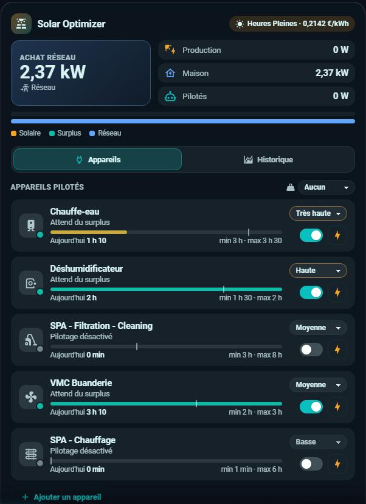
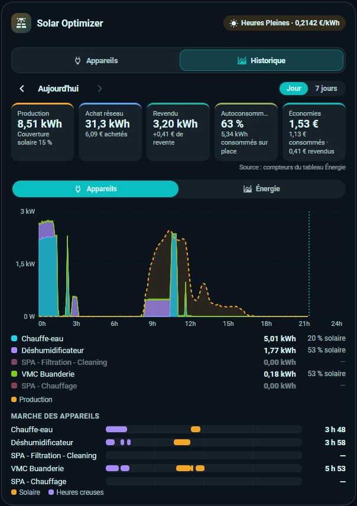

# ☀️ HOLM Solar Optimizer Card

[](https://hacs.xyz/)


🇫🇷 Français · [🇬🇧 English](README.en.md)

**Une interface moderne pour [Solar Optimizer](https://github.com/jmcollin78/solar_optimizer) : le surplus en direct, les appareils pilotés, l'historique et les réglages, réunis dans une seule carte.**

Solar Optimizer reste le moteur : la carte s'appuie uniquement sur ses entités, ses actions et ses propres formulaires de configuration. Rien à installer en plus, aucune entité à créer, aucun redémarrage.

### En bref

- ⚡ **Surplus en direct** : production, consommation de la maison, revente ou achat sur le réseau, puissance pilotée par Solar Optimizer, et le prix du moment (heures pleines / heures creuses).
- 🔌 **Appareils pilotés** : état (en marche, forcé, rattrapage en heures creuses, condition non remplie, en attente du surplus…), priorité modifiable, interrupteur de pilotage automatique et bouton **Forcer** (1 h, 2 h, 4 h, 8 h ou sans limite).
- ⏱️ **Temps de marche** du jour avec une jauge entre le **minimum** et le **maximum** paramétrés, durées minimales de marche et d'arrêt, heure creuse et heure de remise à zéro.
- 📈 **Historique sur une journée** (jours précédents compris) **ou sur 7 jours** : courbes production / consommation / surplus, bandes des heures creuses, frise des périodes de marche de chaque appareil (au solaire ou en heures creuses).
- 🟣 **Le gain réel de Solar Optimizer** : ce que l'autoconsommation des appareils pilotés vous a fait gagner, au total et appareil par appareil.
- 💶 **Autoconsommation et économies** : part consommée sur place et part revendue, en kWh et en %, couverture solaire, et économies en € calculées heure par heure avec le prix réel.
- ⚙️ **Réglages des appareils** (administrateurs) : modifier tous les paramètres d'un appareil ou en **ajouter** un nouveau, avec les formulaires de Solar Optimizer lui-même. La carte signale aussi une condition d'utilisation entourée de guillemets en trop, et propose de la corriger.
- 🗂️ **Compacte** : le direct seul au départ, puis deux onglets à ouvrir d'un clic, comme sur les autres cartes HOLM : **Appareils** (avec le nombre d'appareils en marche) et **Historique**.
- 🌍 **8 langues**, thème clair et sombre, affichage mobile, éditeur visuel.

| Onglet Appareils | Onglet Historique |
|---|---|
|  |  |

### 🆕 Nouveautés de la 1.4.3

- 📖 **Gain Solar Optimizer expliqué** : nouvelle section « Le gain Solar Optimizer en détail » avec un exemple chiffré, et des textes d'aide dans l'éditeur visuel sous les options « Appareils qui auraient tourné en heures creuses », « Appareils masqués » et batterie.

### Nouveautés de la 1.4.2

- ⏸️ **Pause entre deux activations** : un appareil qui attend la fin de sa durée minimale entre deux activations affiche « Pause entre deux activations · disponible à 09:49 » au lieu de « Condition non remplie ». La carte distingue aussi le **maximum du jour atteint** et la **batterie sous le seuil** (merci à Jean-Marc Collin).
- 🟣 **Gain Solar Optimizer** : une nouvelle tuile de l'historique chiffre ce que Solar Optimizer vous fait réellement gagner. La consommation de base de la maison profite du solaire en premier ; le solaire restant consommé par les appareils pilotés, qui sans Solar Optimizer aurait été revendu, est valorisé à (prix d'achat du moment − prix de revente). Le gain de chaque appareil s'affiche sous le graphique Appareils, et l'ancienne tuile devient « Économies solaires » (toute la production autoconsommée). Option `offpeak_devices` pour les appareils qui auraient tourné en heures creuses sans Solar Optimizer, comme un chauffe-eau : leur gain est calculé au prix des heures creuses, fourni par HOLM HP/HC. Idée de Jean-Marc Collin.
- 🌙 **Marches en heures creuses sans HOLM HP/HC** : la frise « Marche des appareils » colore en violet les marches qui démarrent entre l'heure creuse de l'appareil et l'heure de remise à zéro de Solar Optimizer. Avant, seules les heures creuses de HOLM HP/HC étaient reconnues (merci à Jean-Marc Collin).
- 🔋 **Batterie** : une tuile Batterie s'ajoute au direct quand une batterie est déclarée dans Solar Optimizer, avec son état de charge et sa puissance (en charge ou en décharge). Options `battery_entity` et `battery_power_entity` pour choisir d'autres capteurs.

### Nouveautés de la 1.4.1

- 🐛 **Compteurs d'énergie en Wh** : un compteur du tableau Énergie exprimé en Wh (ou en MWh) est maintenant converti en kWh. Avant, sa valeur était lue telle quelle, ce qui gonflait la production, l'autoconsommation et les économies (merci à Jean-Marc Collin).

### Nouveautés de la 1.4.0

- 👁️ **Choisir les appareils du graphique** : sous le graphique « Appareils », un clic sur un appareil le masque ou le réaffiche, un double-clic n'affiche que lui ; la production se masque aussi, pour que l'échelle s'adapte à un petit appareil. Bouton « Tout afficher » ; le choix est retenu par le navigateur.

### Nouveautés de la 1.3.0

- 🔌 **Graphique « Appareils »** dans l'historique, affiché par défaut, à côté du graphique « Énergie » : la puissance de chaque appareil piloté, empilée sous la courbe de production (jour), ou ses kWh par jour (7 jours). Sous le graphique, la consommation de chaque appareil et sa **part solaire**.
- 📏 **Vraies mesures** : la carte trouve seule le capteur de puissance de l'appareil piloté (même appareil dans Home Assistant). Sinon, indiquez-le avec `power_sensors` ; à défaut, la consommation est estimée (puissance max × durée de marche, signalée par ≈).
- Option `history_chart` pour choisir le graphique affiché à l'ouverture.

- 📦 **Carte compacte au départ** : seul le direct s'affiche ; les onglets **Appareils** et **Historique** s'ouvrent d'un clic et se referment de la même façon. Option `default_tab` pour ouvrir un onglet d'office.
- 🏷️ **Barres légendées** : « Production : 62 % consommée sur place · 38 % revendue » et « Maison : 15 % solaire · 85 % réseau ».
- 🗂️ **Onglets** : les appareils pilotés et l'historique passent dans deux onglets, sous le direct toujours visible.
- 🧮 **Bilans identiques au tableau Énergie** : production, achat réseau, revente et autoconsommation sont lus sur les mêmes compteurs que le tableau Énergie de Home Assistant (avant : estimés à partir des puissances moyennes).
- 🔌 **Nouvelle tuile Achat réseau**, avec son coût calculé aux prix déclarés dans le tableau Énergie ; la tuile Revendu affiche le gain de la revente.

### Avec HOLM HP/HC

Si vous utilisez l'intégration [**HOLM HP/HC, Tarification et abonnement**](https://github.com/kaaribou/holm-tarif), la carte le détecte tout seul (`sensor.tarif_actuel`) : période en cours dans l'en-tête, bandes des heures creuses sur le graphique, prix de rachat et taxe de revente pour les économies, et prix des heures creuses pour le gain des appareils `offpeak_devices`. Sans lui, la carte utilise les prix d'achat et de vente déclarés dans Solar Optimizer.

### Lire la carte

**Le direct**
- **Grande tuile** : l'achat sur le réseau (en bleu) ou, quand les panneaux produisent plus que la maison ne consomme, le **surplus** revendu (en vert), avec le prix de revente.
- **Production**, **Maison** (achat réseau + solaire consommé sur place) et **Pilotés** (puissance des appareils allumés par Solar Optimizer). **Batterie**, si vous en avez une : état de charge, et puissance quand elle charge ou décharge.
- **Les deux barres** : la production, partagée entre consommée sur place et revendue ; la consommation de la maison, partagée entre solaire et réseau.
- **En-tête** : la période tarifaire en cours et le prix d'achat du moment ; au survol, le prix de revente.

**Un appareil piloté**
- **Pastille sur l'icône** : jaune et clignotante quand l'appareil est en marche ou forcé, violette en rattrapage heures creuses, verte quand il attend, orange quand quelque chose l'empêche de démarrer, grise quand le pilotage est désactivé.
- **État**, sous le nom :
  - *En marche*, *Forcé jusqu'à 14:00*, *Rattrapage heures creuses* ;
  - *Attend du surplus* : prêt, il démarrera dès qu'il y aura assez de surplus ;
  - *Pause entre deux activations · disponible à 09:49* : la durée minimale entre deux marches n'est pas écoulée ;
  - *Maximum du jour atteint*, *Batterie sous le seuil* ;
  - *Condition non remplie* : la condition d'utilisation réglée dans Solar Optimizer est fausse ;
  - *Pilotage désactivé* : le pilotage automatique est coupé.
- **La jauge** : la barre se remplit avec le temps de marche du jour ; son extrémité droite est le **maximum** par jour. Le **trait vertical** marque le **minimum** par jour. La barre devient verte quand le minimum est atteint (✓) ; sinon, la ligne du dessous indique ce qu'il reste, et l'heure à laquelle Solar Optimizer le **rattrapera en heures creuses**. Un appareil sans minimum n'a pas de trait.
- **Liste déroulante** : la priorité de l'appareil (de très basse à très haute) ; plus elle est haute, plus Solar Optimizer le sert en premier.
- **Interrupteur** : le pilotage automatique par Solar Optimizer.
- **Bouton ⚡ Forcer** : allume l'appareil pendant 1 h, 2 h, 4 h, 8 h ou sans limite, quel que soit le surplus ; il devient ■ pour arrêter.
- **Toucher la ligne** : ouvre le détail des réglages (puissance, durées, heure creuse, condition) et, pour un administrateur, le bouton **Réglages**.

**L'historique**
- **Production**, **Achat réseau** (et son coût), **Revendu** (et son gain), **Autoconsommation** (part de la production consommée sur place).
- **Gain Solar Optimizer** : ce que les appareils pilotés vous ont fait gagner en consommant du solaire qui, sans Solar Optimizer, aurait été revendu (voir « Comment ça marche »).
- **Économies solaires** : toute la production consommée sur place, au prix d'achat du moment, plus la revente.
- **Graphique Appareils** : la puissance de chaque appareil piloté, empilée, sous la courbe de production en pointillés. Dessous, pour chaque appareil : sa consommation, sa part solaire et son gain. Un clic masque ou réaffiche un appareil, un double-clic n'affiche que lui.
- **Graphique Énergie** : production, consommation de la maison et surplus, avec les heures creuses en bandes.
- **Marche des appareils** : une ligne par appareil, avec ses périodes de marche et sa durée totale. Une marche est en violet (heures creuses) quand elle démarre entre l'heure creuse réglée pour l'appareil dans Solar Optimizer et l'heure de remise à zéro, ou pendant les heures creuses de HOLM HP/HC.
- **≈** : valeur estimée (puissance max × temps de marche), faute de capteur de puissance pour cet appareil.

### Le gain Solar Optimizer en détail

**Ce qu'il mesure.** L'argent que Solar Optimizer vous fait gagner en faisant consommer par vos appareils du solaire qui, sans lui, serait parti sur le réseau.

**Comment il est calculé**, toutes les 5 minutes :
1. **Consommation de base** = consommation de la maison − puissance des appareils pilotés. C'est ce que la maison aurait consommé de toute façon ; elle profite du solaire en premier.
2. **Solaire restant** = production − consommation de base. Sans Solar Optimizer, il aurait été revendu.
3. **Solaire capté** = la part de ce solaire restant réellement consommée par les appareils pilotés (partagée entre eux selon leur puissance).
4. **Gain** = solaire capté × (prix d'achat − prix de revente).

**Exemple** : à midi, les panneaux produisent 3 000 W, la maison consomme 800 W sans les appareils pilotés, et Solar Optimizer allume le chauffe-eau (2 000 W). Les 2 000 W du chauffe-eau viennent du solaire restant (3 000 − 800 = 2 200 W). Sur une heure, cela fait 2 kWh captés ; avec un achat à 0,21 € et une revente à 0,04 €, le gain vaut 2 × (0,21 − 0,04) = **0,34 €**.

**Quel prix d'achat ?** Par défaut, **le prix du moment**, avec les heures pleines et creuses si vous utilisez [HOLM HP/HC](https://github.com/kaaribou/holm-tarif). C'est juste pour un appareil qui aurait tourné à ce moment-là de toute façon : VMC, déshumidificateur, spa, piscine. Mais un **chauffe-eau** aurait chauffé la nuit sans Solar Optimizer : le kWh solaire qu'il consomme à midi ne vous évite qu'un kWh payé au **prix des heures creuses**. Sélectionnez ces appareils dans l'option **Appareils qui auraient tourné en heures creuses** (`offpeak_devices`) : leur gain est calculé au prix HC. Dans l'exemple, avec des heures creuses à 0,16 €, le gain du chauffe-eau passe à 2 × (0,16 − 0,04) = **0,24 €**. Cette option nécessite HOLM HP/HC, qui fournit le prix des heures creuses ; sans lui, elle n'a pas d'effet.

**Bon à savoir**
- Un prix de revente élevé réduit le gain : moins l'écart entre achat et revente est grand, moins Solar Optimizer rapporte par kWh.
- Les marches forcées ou de rattrapage la nuit, alimentées par le réseau, ne comptent pas : elles ne captent pas de solaire.
- Un appareil sans capteur de puissance a une consommation estimée : son gain est marqué ≈.
- Une batterie n'est pas prise en compte : sans Solar Optimizer, une partie du surplus l'aurait peut-être chargée au lieu d'être revendue.
- **Économies solaires**, l'autre tuile, valorise toute la production consommée sur place, que Solar Optimizer y soit pour quelque chose ou non.

---

## Installation

### Via HACS (recommandé)

1. HACS → menu ⋮ → **Dépôts personnalisés** → ajoutez `https://github.com/kaaribou/holm-solar-optimizer-card`, catégorie **Tableau de bord**.
2. Recherchez **HOLM Solar Optimizer Card** et installez.
3. Rechargez la page (Ctrl + F5).

### Manuelle

1. Copiez `holm-solar-optimizer-card.js` dans `config/www/community/holm-cards/`.
2. Paramètres → Tableaux de bord → ⋮ → **Ressources** → ajoutez `/local/community/holm-cards/holm-solar-optimizer-card.js?v=1.4.3`, type **Module JavaScript**.
3. Rechargez la page (Ctrl + F5).

Prérequis : l'intégration [Solar Optimizer](https://github.com/jmcollin78/solar_optimizer) installée et configurée (version récente, avec les actions `solar_optimizer.start_device` et `stop_device`).

## Configuration

Ajoutez la carte **HOLM – Solar Optimizer** depuis le sélecteur de cartes. Sans aucune option, elle trouve seule les appareils et les capteurs de Solar Optimizer.

```yaml
type: custom:holm-solar-optimizer-card
title: Solar Optimizer
history_mode: day      # day (journée) ou week (7 jours)
```

| Option | Description | Par défaut |
|---|---|---|
| `title` | Titre | `Solar Optimizer` |
| `language` | Langue de la carte : `fr`, `en`, `de`, `es`, `it`, `nl`, `pt`, `pl` | celle du profil |
| `show_live` | Afficher le direct | `true` |
| `show_devices` | Afficher les appareils pilotés | `true` |
| `show_history` | Afficher l'historique | `true` |
| `default_tab` | Onglet ouvert au départ : `none` (carte repliée), `devices` ou `history` | `none` |
| `history_mode` | Historique affiché à l'ouverture : `day` ou `week` | `day` |
| `history_chart` | Graphique affiché à l'ouverture : `devices` ou `energy` | `devices` |
| `power_sensors` | Capteur de puissance réel d'un appareil piloté, quand il n'est pas sur le même appareil (voir ci-dessous) | — |
| `exclude` | Appareils à masquer (`switch.solar_optimizer_…`) | — |
| `offpeak_devices` | Appareils qui auraient tourné en heures creuses sans Solar Optimizer (ex. chauffe-eau) : leur gain est calculé au prix HC de HOLM HP/HC (voir « Le gain Solar Optimizer en détail ») | — |
| `production_entity` | Capteur de production solaire (W) | celui de Solar Optimizer |
| `grid_entity` | Consommation nette (W, négative à la revente) | celle de Solar Optimizer |
| `battery_entity` | État de charge de la batterie (%) | celui de Solar Optimizer |
| `battery_power_entity` | Puissance nette de la batterie (W, positive en décharge) | celle de Solar Optimizer |
| `price_entity` | Prix d'achat (€/kWh) | celui de Solar Optimizer, ou `sensor.tarif_actuel` |

L'éditeur visuel est disponible.

**Capteur de puissance d'un appareil** : la carte cherche un capteur de puissance sur le même appareil que l'entité pilotée (le chauffe-eau et son `sensor.chauffe_eau_power`, par exemple). Si la mesure vient d'une prise connectée à part, indiquez-la :

```yaml
power_sensors:
  switch.solar_optimizer_deshumidificateur: sensor.prise_deshumidificateur_power
```

## Comment ça marche

- **Le direct** : la grande tuile montre l'achat réseau, ou le surplus revendu quand les panneaux produisent plus que la maison ne consomme. Production, Maison (achat réseau + solaire consommé sur place) et Pilotés (puissance des appareils allumés par Solar Optimizer) complètent. Les deux barres répartissent la production (consommée sur place / revendue) et la consommation de la maison (solaire / réseau). Le direct lit les capteurs déclarés dans Solar Optimizer (production et consommation nette). Le surplus est la puissance revendue sur le réseau ; la consommation de la maison est l'achat réseau plus la production consommée sur place.
- **Forcer un appareil** appelle `solar_optimizer.start_device` (avec ou sans durée) ; **Arrêter** appelle `solar_optimizer.stop_device`. Pendant un forçage, Solar Optimizer désactive le pilotage automatique et le rétablit à la fin.
- **Les bilans** (production, achat, revente, autoconsommation) viennent des compteurs d'énergie déclarés dans le **tableau Énergie** de Home Assistant, par tranches de 5 minutes : ce sont les mêmes chiffres, à jour jusqu'aux 5 dernières minutes (les cartes basées sur les statistiques horaires s'arrêtent à la dernière heure terminée). Le coût de l'achat utilise les prix du tableau Énergie ; les économies additionnent l'énergie consommée sur place, au prix d'achat de l'instant, et la revente. Sans tableau Énergie, la carte se rabat sur les puissances moyennes ; la source est indiquée sous les tuiles.
- **Le graphique Appareils** additionne la puissance de chaque appareil (statistiques sur 5 minutes de son capteur). Sa part solaire est le solaire qu'il a consommé au-delà de la consommation de base de la maison.
- **Le gain Solar Optimizer** compare avec une maison sans Solar Optimizer : toutes les 5 minutes, la consommation de base (maison sans les appareils pilotés) prend le solaire en premier ; le solaire restant consommé par les appareils pilotés aurait été revendu. Il est valorisé à (prix d'achat du moment − prix de revente), ou au prix des heures creuses pour les appareils de `offpeak_devices`. Une batterie n'est pas prise en compte : sans Solar Optimizer, une partie de ce surplus l'aurait peut-être chargée.
- **Les courbes** viennent des statistiques de puissance sur 5 minutes (conservées 10 jours par défaut) et la frise de l'historique des appareils.
- **Les réglages** ouvrent les formulaires d'options et d'ajout de Solar Optimizer, comme dans Paramètres → Appareils et services : la carte n'écrit rien d'autre. La suppression d'un appareil reste dans Home Assistant.

## FAQ

**Je ne vois pas le bouton Réglages.** Il est réservé aux administrateurs de Home Assistant, comme les formulaires de configuration.

**L'achat réseau est un peu plus élevé que sur une autre carte.** Les cartes qui lisent les statistiques horaires ne comptent pas l'heure en cours ; la HOLM Solar Optimizer Card l'inclut.

**Le temps de marche du jour diffère de la frise.** Solar Optimizer remet ses compteurs à zéro à l'heure de remise à zéro (5 h par défaut), alors que la frise compte de minuit à minuit.

**Le graphique « 7 jours » est vide au-delà de 10 jours.** Les statistiques sur 5 minutes ne sont gardées que 10 jours par défaut (option `purge_keep_days` du recorder).

---

Fait partie de **HOLM — Home Orchestration & Living Management** : la gestion et l'orchestration intelligente de la maison.

Les autres projets : [Volets HOLM](https://github.com/kaaribou/volets-holm) · [Climat HOLM](https://github.com/kaaribou/climat-holm) · [Carburant HOLM](https://github.com/kaaribou/carburant-holm) · [Commandes à la maison HOLM](https://github.com/kaaribou/commandes-holm) · [HOLM LaMetric](https://github.com/kaaribou/lametric-holm) · [HOLM My Menu](https://github.com/kaaribou/holm-mymenu) · [HOLM Lektrico](https://github.com/kaaribou/lektrico-holm) · [HOLM GitHub](https://github.com/kaaribou/github-holm) · [HOLM Navbar Card](https://github.com/kaaribou/holm-navbar-card) · [HOLM Climate Card](https://github.com/kaaribou/climate-card-holm) · [HOLM Music Card](https://github.com/kaaribou/holm-music-card) · [HOLM Sentinel Card](https://github.com/kaaribou/holm-sentinel-card) · [HOLM Security Card](https://github.com/kaaribou/holm-security-card) · [HOLM Recordings Card](https://github.com/kaaribou/holm-recordings-card) · [HOLM Covers Card](https://github.com/kaaribou/holm-covers-card) · [HOLM Runtime Card](https://github.com/kaaribou/holm-runtime-card) · [HOLM Power Flow Card](https://github.com/kaaribou/holm-power-flow-card) · [HOLM Energy Cards](https://github.com/kaaribou/holm-energy-cards) · [HOLM Radiator Card](https://github.com/kaaribou/holm-radiator-card) · [HOLM Floor Card](https://github.com/kaaribou/holm-floor-card) · [HOLM Ecojoko Card](https://github.com/kaaribou/holm-ecojoko-card) · [HOLM Smoke Card](https://github.com/kaaribou/holm-smoke-card) · [HOLM BG Card](https://github.com/kaaribou/holm-bg-card).

Licence MIT · Non affilié à Solar Optimizer. · [☕ Offrir une bière](https://paypal.me/kaaribou)
